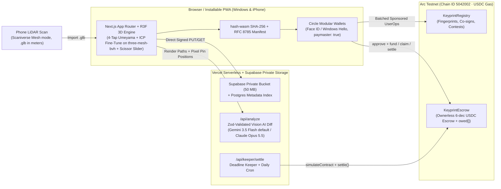

# Keyprint

**Your apartment. Its history. Your proof.**

Keyprint is a renter-owned, tamper-evident 3D record of an apartment paired with a rule-enforced USDC security-deposit escrow on Arc Testnet. Built for the **UBC 2026 Hackathon** (University Blockchain Conference, UT Austin) · **Main Track:** Consumer Applications · **Chain Award:** Best use of Arc.

- **Live Demo:** [https://keyprint-two.vercel.app](https://keyprint-two.vercel.app)
- **Demo Video (2–3 min):** _Add unlisted YouTube / Google Drive link here_
- **On Arc Testnet:** [`KeyprintRegistry`](https://explorer.testnet.arc.io/address/0x57cF232F1e0c250d6bcA49Af6461ee477f450341) and [`KeyprintEscrow`](https://explorer.testnet.arc.io/address/0x97d85aC09C01ed2dBf2611b7B91fF4BB2A69654a), both ownerless (no admin key, no proxy). One full 12-transaction scripted lease cost **$0.031613** in USDC network fees ([receipts](#a-full-lease-on-arc-testnet--measured-usdc-gas-cost)).

---

## Try It in Two Minutes

1. Open **`/sample`** in an incognito window for an illustrative walkthrough: a public research scan of a real apartment with move-in pins, the before/after time slider, an example AI suggestion, and an example `$40` / `$160` split. (The sample's claims and split are scripted to show the flow; the real, scripted $2 test lease on Arc Testnet is linked below.)
2. Download both sample `.glb` files (original + 1-byte-changed copy) and drop them into **`/verify`**.
3. Open **`/unit/new`** to seal a 3D scan and spatial pins in **Solo mode** with your own passkey (no landlord and no deposit required). Have a phone LiDAR scan? Export it as `.glb` (I used Scaniverse's Mesh mode) and load it with **Import .glb scan from device**.

---

## The Problem

Your landlord holds your deposit *and* the evidence. From Zillow's [Consumer Housing Trends Report 2024](https://www.zillow.com/research/renters-housing-trends-report-2024/):

- **87%** of recent renters paid a security deposit, and the typical deposit was **$750**.
- Of recent renters who moved out, only **40%** got all of it back: 18% got most, 9% some, and **24% got none**.
- **41%** disagreed with their landlord about something: **19%** over damage or repairs, **16%** over move-out costs.
- Documentation alone doesn't settle it: renters who documented everything got a full refund **50%** of the time, versus **41%** for those who documented nothing.

The evidence is starting to exist by law: California's AB 2801 now requires landlords to photograph units at move-in and around deducted repairs ([SF.gov](https://www.sf.gov/upcoming-changes-to-security-deposit-laws-photograph-requirements)). The open question is who controls that evidence, and who holds the money while it's argued over.

## The Flip

| | Today | With Keyprint |
| --- | --- | --- |
| **Who holds the deposit** | The landlord | An ownerless escrow contract on Arc that neither side controls |
| **Who holds the evidence** | The landlord's phone | Both sides; each file's fingerprint is sealed on Arc the moment it's added, and the landlord co-signs or contests it |
| **Who has to act to get paid** | The renter, who has to chase money the landlord already holds | The landlord, who must pin each claim to a spot in the 3D record and price it |
| **If the landlord files nothing** | The money stays with the landlord | Once either side ends the lease with a sealed move-out scan and the claim deadline passes, the full deposit goes back to the renter: Keyprint's keeper triggers it, and anyone can |

---

## How It Works

1. **Scan:** capture the apartment with a phone LiDAR app and export a `.glb`. A scanning app reconstructs the 3D model; the evidence history, comparison, and settlement are Keyprint's. My own test scans are two LiDAR scans of one room corner (it includes a staircase) made with **Scaniverse (Mesh mode) on an iPhone Pro**, exported as `.glb` (~9 MB, ~106k–129k triangles, real-world meters) and loaded through **Import .glb**.
2. **Seal at move-in:** pin damage that's already there (a note plus an optional close-up photo). One passkey touch (Face ID or Windows Hello) seals the scan and pins on Arc and, in Full mode, protects the deposit in escrow; the landlord co-signs or contests. **Solo mode** seals for free with no landlord and no deposit. During the lease, either side can tap the 3D room to seal a timestamped pin ("Leak under sink, reported").
3. **Line up at move-out:** tap the same 4 spots in both scans; Keyprint fine-tunes the fit automatically and unlocks the comparison only when the surfaces agree. Then drag the before/after slider across the same wall.
4. **AI suggests, code matches, people decide:** a vision model lists possible changes, code (not the model) checks each one against move-in pins, and the model never prices anything. After move-out, the compare page is read-only and shows the sealed change report.
5. **Every dollar needs a pin and a price:** the landlord pins and prices each claim; a claim that lands on a move-in pin is shown next to that pin's close-up photo, and the renter approves or disputes line by line.
6. **Money moves by rules:** once every claim is final, one settlement pays both sides in USDC. If the landlord files nothing by the deadline, the full deposit goes back, and the settle page says whether Keyprint's keeper released it automatically or a party did with one tap.

---

## How Keyprint Compares

Other tools already document apartments well:

- **[Tenant Trace](https://apps.apple.com/app/id6764883731)** (iOS) already offers LiDAR scans, cryptographically fingerprinted photos, public verification and co-signing. Its listing doesn't mention handling the deposit.
- **[RentCheck](https://www.getrentcheck.com/)** is sold to property managers and guides tenants through timestamped photos.
- **Deposit alternatives** replace the deposit instead of protecting it. Per the [National Consumer Law Center's 2026 report](https://www.nclc.org/wp-content/uploads/2026/05/2026.05_Report_Tenant-Insecurity_corrected.pdf): with Rhino / Greenlight Rent the renter pays a nonrefundable surety-bond premium and repays claims the bond pays out; LeaseLock is zero-deposit insurance with a monthly fee; Obligo charges the renter's account, and NCLC found it required no proof of claims.

**Keyprint's difference is that the evidence and the money live together.** The deposit sits in an ownerless escrow on Arc. The contract only accepts a claim backed by the landlord's own evidence sealed after move-out, and in Keyprint that evidence is a priced pin on the sealed 3D record (a claim filed around the app is flagged "Not a priced pin" next to a Dispute button). Missed deadlines default in code: no claims means a full refund, an unanswered claim counts as accepted, and an unresolved dispute goes back to the renter. And the renter owns the record and can use it alone in free Solo mode, with no landlord sign-up.

---

## Architecture (3 Layers)



1. **Browser (Next.js App Router + React Three Fiber + three-mesh-bvh + hash-wasm):**
   - Hashes `.glb` scans and photos in streaming chunks (`hash-wasm`), canonicalizes manifests per RFC 8785 (`canonicalize`), and signs gas-sponsored ERC-4337 UserOperations with passkeys via Circle Modular Wallets.
   - Lines up the move-out scan in two steps. **4 hand taps** give a Umeyama similarity fit (`ml-matrix`). Then an **automatic fine-tune** snaps the surfaces together: point-to-plane ICP pairs sampled move-out points with their closest points on a `three-mesh-bvh` index of the move-in scan, drops any pair outside the pairing radius, and shrinks that radius from 30 cm to 3 cm. The fit is rigid (it keeps the tap scale, or true size, since phone LiDAR scans are already in meters), so a scan can't shrink to fake a match. If the first pass isn't clearly good, it retries at true size, leveled, from a wider radius, from one-step shifts (repeating geometry like the stairs in my test corner can create false fits one step off) and from small turns, within a 2.5 s budget. The fine-tuned fit is kept only if it beats the taps and its gate result is at least as good. Comparisons stay locked until the surfaces agree: median gap `<= 2 cm` and `>= 60%` of sampled points within `5 cm`.
   - Measured on my two real phone scans with simulated taps off by 2–4 cm per axis: the fine-tuned fit passed the gate in **15 of 15** trials, while the taps alone passed only **1–4 of 15** across runs, and the slowest fine-tune took about **1.4 s** on a laptop. The best achievable fit between those two scans is about a **1.6 cm** median gap with about **75%** of the surface within 5 cm. A synthetic room-corner test also passed 15 of 15.
   - Renders matching 1024×768 4:3 before/after pairs offscreen (one view per move-in pin for up to 6 pins, up to 2 close views of spots where the move-out surface's color clearly differs from move-in, then coverage views of the floor and walls, up to 12 pairs in all) and matches AI suggestions to move-in pins strictly in geometric code (`<= 15 cm` in 3D, or a visible move-in pin inside the AI's 2D box grown by 10%, which must also be within `0.5 m` whenever the box's center lands on the scan).
2. **Arc Testnet (Chain ID `5042002`):**
   - `KeyprintRegistry`: ownerless, immutable onchain registry storing manifest SHA-256 hashes, timestamps, monotonic seal sequence numbers, and per-account `acknowledgedAt` co-signs.
   - `KeyprintEscrow`: ownerless, non-upgradeable 6-decimal ERC-20 USDC (`0x3600000000000000000000000000000000000000`) escrow enforcing lease terms, evidence checks, claim windows, two-sided silence rules, reviewer dispute resolution, permissionless settlement, and non-blocking `owed[]` payouts.
3. **Private Storage & Server Routes (Supabase + Vercel):**
   - 3D scans and photos live in a **private** Supabase Storage bucket (`keyprint-private`) uploaded directly from the browser via short-lived signed URLs (never public IPFS, never routed through Vercel's 4.5 MB limit). Move-in pin close-up photos are shown next to matched claims through short-lived server-signed links.
   - `/api/analyze` runs the structured vision comparison server-side, and only for a real lease on Arc compared against that lease's own sealed move-in record. It uses **Google Gemini** (`GEMINI_API_KEY`: views are sent in parallel batches of three; each batch asks `gemini-3.5-flash` and the faster `gemini-3.5-flash-lite` at the same time and keeps the more accurate answer if it arrives within a short grace period, with `gemini-3.8-flash` as a backup, so one overloaded model can't stall the comparison), or **Anthropic Claude Opus 5.5** first when `ANTHROPIC_API_KEY` is configured. Output is structured JSON validated with Zod; besides the renders, the model sees only short view labels and pixel pin positions; boxes are clamped to the 1024×768 render; and the model never prices anything. Reports are cached in Supabase (keyed by lease + move-in record ID + the move-out file's SHA-256 + view IDs + prompt version), and the change list on screen is sealed in the same touch that ends the lease; if the AI is unavailable, people add changes by hand. In a live test on synthetic before/after images, `gemini-3.5-flash` answered one pair in about 5 s, found both planted changes (a floor stain and a wall hole), and ignored a pre-existing scratch. On the two real phone scans (the staged sticky note was on a wall none of the fixed overview cameras face), the change-spotting step aimed a camera at it and the comparison returned exactly one item, "Sticky note on wall" (possible wear, high confidence, box on the note), in about 17 s with the batches sent in parallel.
   - `/api/keeper/settle` simulates and triggers permissionless `settle(leaseId)` once deadlines expire (backed by a daily Vercel Cron job).

---

## Why Arc

*For the Best use of Arc judges: the evidence fingerprints, co-signs, deposit, claims, deadlines, and payouts all live in two contracts on Arc Testnet, and every lease screen reads the lease and its claims straight from `KeyprintEscrow` every 2 seconds.*

A deposit is dollars, and Keyprint's job is moving dollars by rules. That's why it runs on Arc:

- **Fees in dollars, and predictable.** USDC is Arc's gas token, so every network fee is a dollar amount. A full 12-transaction scripted lease cost **$0.031613** (about 3 cents), and each lease's settlement receipt adds up the USDC network fees of its main passkey steps (lease creation, contests, mid-lease pins and Keyprint's keeper transaction aren't counted yet).
- **Final in one block.** Arc's finality is deterministic and sub-second, so one receipt is final: Keyprint shows "Sealed" as soon as the receipt arrives, stamps the seal with that Arc block's time, and runs every countdown on Arc's clock. No confirmation counting, no reorg handling.
- **No wallet app, no gas token, no seed phrase.** Circle Modular Wallets give each person a passkey smart account (Face ID or Windows Hello) that batches several contract calls into one touch, and Circle Gas Station sponsors the gas for every passkey action.
- **Nobody holds the keys.** Both contracts are ownerless: no admin key, no pause, no proxy. Not even Keyprint can move a deposit outside the rules, and anyone can trigger settlement.

### Where Each Piece Is Used in the Code

| Arc / Circle piece | What it does in Keyprint | Where |
| --- | --- | --- |
| **USDC as gas** (native, 18 decimals) | In the app, fees are read from each UserOperation's `actualGasCost` and shown in dollars on the settlement receipt; the scripted 12-transaction run below measured `gasUsed × effectiveGasPrice` from each plain transaction receipt | `src/lib/chain/wallet.ts` (`sendSponsoredCalls`), `src/lib/chain/arc.ts` (`formatNativeUsdcFee`), `src/app/lease/[id]/settle/page.tsx`, `scripts/run-arc-verification.mjs` |
| **USDC ERC-20 interface** (`0x3600…0000`, 6 decimals) | Deposits, claims, and payouts. It's the same USDC balance as gas, but deposit units and fee units are never mixed | `contracts/src/KeyprintEscrow.sol`, `src/lib/chain/arc.ts` (`ARC_USDC_ADDRESS`, `formatDollars`) |
| **Deterministic finality** | One receipt is final; seal times come from the Arc block; countdowns use Arc's latest block time; the keeper's `settle()` is final on its receipt | `src/lib/chain/wallet.ts` (`sendSponsoredCalls`, `sealTimeIso`), `src/components/useLeaseLiveState.ts`, `src/app/api/keeper/settle/route.ts` |
| **Circle Modular Wallets** | Passkey smart accounts on Arc Testnet (`toWebAuthnCredential`, `toPasskeyTransport`, `toModularTransport(…/arcTestnet)`, `toCircleSmartAccount`) | `src/lib/chain/wallet.ts`, `src/app/start/page.tsx` |
| **Circle Gas Station** | `paymaster: true` on every UserOperation; one move-in touch seals the scan and pins and runs the USDC `approve` and `fund` | `src/lib/chain/wallet.ts` (`sendSponsoredCalls`), `src/app/lease/[id]/capture/page.tsx` |
| **Ownerless contracts** | Evidence registry and escrow with immutable settings, covered by 20 Foundry tests including fuzz and invariant tests | `contracts/src/KeyprintRegistry.sol`, `contracts/src/KeyprintEscrow.sol`, `contracts/test/` |
| **Arc as the source of truth** | Verify re-hashes files in the browser and checks Arc; the AI route and the metadata index check Arc before they act | `src/app/verify/page.tsx`, `src/app/api/analyze/route.ts`, `src/app/api/records/route.ts`, `src/app/api/leases/` |
| **EVM compatibility** | Standard Solidity, Foundry, and viem (`arcTestnet` from `viem/chains`, chain ID `5042002`) | `contracts/`, `src/lib/chain/arc.ts` |

**Onchain (Arc):** fingerprints of every scan, pin (including its photo's hash), alignment, change report (when the change list isn't empty, whether the changes came from the AI or were added by hand), and claim evidence; co-signs and contests; the deposit, every claim, and every payout. **Offchain:** the files themselves (private Supabase storage) and a metadata index that's checked against Arc on every write.

### Circle Details

- **Passkeys (`@circle-fin/modular-wallets-core` + `viem`):** renters sign in with Face ID or Windows Hello and never handle a seed phrase. Face ID sign-up works on iPhone: tested in Safari on the live site on Nov 20, 2026. The sign-up page prefetches Circle's passkey options so Safari opens Face ID immediately after the tap, and usernames are normalized for Circle (5–50 characters, no spaces). Main screens talk in dollars; account IDs only appear where you share or paste them.
- **Gas Station sponsorship (`paymaster: true`):** every passkey action (seal, co-sign, priced-pin claim, dispute, withdrawal, manual release) runs as a gas-sponsored UserOperation on Arc Testnet, batching several contract calls into one touch where a step needs them (for example seal move-in + pins + approve + fund). The deadline keeper's `settle()` is a plain transaction from Keyprint's keeper account.
- **USDC units:** deposits and payouts use the 6-decimal ERC-20 interface (`0x3600000000000000000000000000000000000000`), while Arc gas is metered in 18-decimal native USDC (measured from `actualGasCost` on UserOp receipts). It's one USDC balance seen through two interfaces, and the two units are never mixed.
- **Next (not built):** Circle Gateway and CCTP so a renter can fund a deposit with USDC from any chain.

### Arc Testnet Contracts

| Contract | Address | Explorer |
| --- | --- | --- |
| USDC (ERC-20 interface, 6 decimals) | `0x3600000000000000000000000000000000000000` | [Arc Testnet Explorer](https://explorer.testnet.arc.io/address/0x3600000000000000000000000000000000000000) |
| `KeyprintRegistry` | `0x57cF232F1e0c250d6bcA49Af6461ee477f450341` | [Arc Testnet Explorer](https://explorer.testnet.arc.io/address/0x57cF232F1e0c250d6bcA49Af6461ee477f450341) |
| `KeyprintEscrow` (`MIN_WINDOW = 60s`) | `0x97d85aC09C01ed2dBf2611b7B91fF4BB2A69654a` | [Arc Testnet Explorer](https://explorer.testnet.arc.io/address/0x97d85aC09C01ed2dBf2611b7B91fF4BB2A69654a) |

### A Full Lease on Arc Testnet & Measured USDC Gas Cost

One complete lease lifecycle ran on Arc Testnet via `scripts/run-arc-verification.mjs`, from two plain test accounts (**12 transactions**: create, seal move-in, approve, fund, co-sign, seal move-out, end lease, seal claim evidence, file claim, close claims, accept, settle). In the app, several of these steps are batched into a single passkey touch. Measured native gas fees totaled **$0.031613 USDC**:

- **Lease ID:** `0xb43bc65443fd2847b3c37b0fc08035c033a290ddf75707993649f44e1ea2f1a4`
- **Co-Signed Move-In Record ID (verifiable live at `/verify`):** `0xf832a330403ee154d148051bccdd595d2e82d523142d8ae3dc4950d747818d50`
- **Total Measured Arc Gas Cost:** **`$0.031613` USDC** across 12 transactions (block `72,986,126`–`72,986,180`)

| Step | Block | Gas Fee (USDC) | Explorer |
| --- | --- | --- | --- |
| `createLease` | `72,986,126` | `$0.004768` | [View tx](https://explorer.testnet.arc.io/tx/0x2e1fdfc4a23dd512b0dfc7609bd7ee648179b69eff6577cdba454bab51db795c) |
| `seal(MoveInScan)` | `72,986,127` | `$0.003045` | [View tx](https://explorer.testnet.arc.io/tx/0x8dec8fb7abe28012b87de674f8d12f6709ad0937857a3635a73b86ff51733d26) |
| `USDC.approve(2 USDC)` | `72,986,129` | `$0.001164` | [View tx](https://explorer.testnet.arc.io/tx/0x20d9c052e595f58844add3730f7d9eb1072ec34ae48c84a03a353923f6a0bbff) |
| `fund(2 USDC)` | `72,986,131` | `$0.003268` | [View tx](https://explorer.testnet.arc.io/tx/0x2d55caff5ecf5a619844fc86f71f3361c2b2228a72a5cadad603d4d67c4dd2a8) |
| `acknowledge` (landlord co-sign) | `72,986,140` | `$0.001016` | [View tx](https://explorer.testnet.arc.io/tx/0x0e385aaf44650fb858854374cb7db81df7f233b3f7efbd441880595036670868) |
| `seal(MoveOutScan)` | `72,986,143` | `$0.003463` | [View tx](https://explorer.testnet.arc.io/tx/0x87989f384178a02ae23e2cd721f705a8a4de55b0b305bd54f67511704baddfa8) |
| `endLease` | `72,986,145` | `$0.001776` | [View tx](https://explorer.testnet.arc.io/tx/0xf75c154698b3b99b62810fe7ed7579f9f0a4e7068068ef49c93bdf00aa494d05) |
| `seal(ClaimEvidence)` | `72,986,154` | `$0.003463` | [View tx](https://explorer.testnet.arc.io/tx/0x668f5ed0d872b637ac1336c2cfadaa16850fbfb3dd6699291d7c0b6011a99bb7) |
| `fileClaim(1 USDC)` | `72,986,162` | `$0.005461` | [View tx](https://explorer.testnet.arc.io/tx/0x846039376d2f30a14baf5355c8a84ce90c695043a96c264d2cd7967b3733f015) |
| `closeClaims` | `72,986,164` | `$0.000692` | [View tx](https://explorer.testnet.arc.io/tx/0x3d765c9179f35344a5250e1e3c0374b583c2ada1566150f3c2c8474d058abdbf) |
| `acceptClaim` | `72,986,173` | `$0.000944` | [View tx](https://explorer.testnet.arc.io/tx/0xe6822ec3b085057af19c6760e684cd5b94883f66d3216ab91f1c8d0930a60e28) |
| `settle` (`$1` landlord / `$1` renter) | `72,986,180` | `$0.002553` | [View tx](https://explorer.testnet.arc.io/tx/0xc68f98a864221173d420503f60096e51b955ac2ced914557f66505d6caf81d1d) |

---

## Escrow Design & Risk Assumptions

- **No admin key, no pause, no proxy:** Nobody, Keyprint included, can freeze or redirect escrowed deposits.
- **Evidence checks:** `fund` requires a renter-sealed `MoveInScan` for that lease; `endLease` can only be called on or after `leaseEnd` and requires a `MoveOutScan` sealed after funding by the renter or landlord; `fileClaim` requires a fresh, post-move-out landlord-sealed `ClaimEvidence` record (`>= 1 USDC`, max 20 claims, non-withdrawn total `<= deposit`).
- **Silence both ways:** An unanswered claim counts as accepted after `responseWindow`; an unresolved dispute counts as `$0` (returned to renter) after `resolveWindow`. Both defaults are disclosed on the terms card before the renter pays.
- **Non-blocking settlement (`owed[]`):** If USDC's issuer blocklists a recipient and a transfer fails during `settle()`, the failed amount is credited to `owed[address]` for `withdraw()` so one party can never freeze the other's payout.
- **Permissionless settlement:** Contracts do not self-execute; once the rules allow settlement, Keyprint's keeper calls `settle()`, the renter has a one-tap *"Release my deposit"* fallback, and any external account can trigger it. The settle page shows which path released the deposit: automatically by Keyprint's keeper, or with one tap by the renter or landlord.

---

## Local Setup & Deployment

### Prerequisites

- Node.js `22+`
- Foundry (run in **Git Bash** or **WSL** on Windows — see `contracts/README.md`)
- Circle Developer Console account (Client Key + Passkey Domain for `localhost` and your Vercel production domain)
- Supabase project (run `supabase/schema.sql` in SQL Editor)
- Google Gemini API key (`GEMINI_API_KEY`, the default AI path) and/or Anthropic API key (`ANTHROPIC_API_KEY`, tried first with Claude Opus 5.5 when set)

### 1. Install & Test Web App

```bash
cp .env.example .env.local
npm install
npm test
npm run dev
```

### 2. Build, Test & Deploy Contracts (Git Bash / WSL)

```bash
cd contracts
forge build && forge test -vv

# Deploy to Arc Testnet (MIN_WINDOW = 60 seconds for demo)
forge create src/KeyprintRegistry.sol:KeyprintRegistry \
  --rpc-url "$ARC_RPC" --private-key "$DEPLOYER_KEY" --broadcast

forge create src/KeyprintEscrow.sol:KeyprintEscrow \
  --rpc-url "$ARC_RPC" --private-key "$DEPLOYER_KEY" --broadcast \
  --constructor-args 0x3600000000000000000000000000000000000000 "$REGISTRY_ADDRESS" 60
```

---

## What I Built vs. Used & Honest Limitations

- **Built:** `KeyprintRegistry` and `KeyprintEscrow` smart contracts + full Foundry adversarial/fuzz/invariant suite (20 tests), RFC 8785 manifest sealing & client-side `/verify`, 4-tap Umeyama alignment + automatic point-to-plane ICP fine-tune (rigid, with retries) + `three-mesh-bvh` surface-agreement gate, dual-pass scissor time slider, offscreen 4:3 rendering + Zod-validated structured vision-AI diff + geometric pin matching, sealed read-only change report, priced-pin claims shown beside move-in pin photos, settlement keeper, and all consumer screens.
- **Used:** **Scaniverse** (Mesh mode, iPhone Pro LiDAR) for the 3D reconstruction of my own phone scans, imported as `.glb`; Meta AI's real-world **Replica Dataset** `apartment_1.glb` RGB-D apartment scan, optimized and prepared as the built-in sample move-in/move-out pair (with a clearly disclosed staged floor stain & scan-frame offset on the move-out copy); Circle Modular Wallets + Gas Station on Arc; Supabase private Storage/Postgres; Vercel; Google Gemini 3.5 Flash and Anthropic Claude Opus 5.5 APIs; open-source libraries (three.js, React Three Fiber, three-mesh-bvh, ml-matrix, hash-wasm, canonicalize, viem, OpenZeppelin); AI coding assistants for help writing and reviewing code.
- **Demo data, disclosed wherever it appears:** the real-scan demo uses my two Scaniverse LiDAR scans of one room corner, and its "damage" is a staged sticky note. The built-in sample apartment (`/sample` and the Verify demo files) is Meta's Replica research scan; its move-out copy is the same scan with a synthetic frame offset and a staged stain, and its claims and split are an example.
- **Honest limitations:**
  - The alignment numbers above come from my two scans of one room corner (plus a synthetic test); many more rooms and phones still need testing.
  - AI accuracy has only been checked in two small live tests with planted damage (synthetic images and the two real scans); its labels are suggestions, not findings.
  - There is no server-side account login yet: every index write is checked against Arc, but anyone holding a lease link can open that lease's scans.
  - 3D reconstruction comes from an external scanning app; in-app capture with device attestation is next.
  - The move-in review window, alignment gate, and priced-pin schema are enforced by the app, while the contract enforces evidence existence, authorship, ordering, deadlines, and payouts.
  - Settlement requires a trigger (Keyprint's keeper or any caller).
  - Everything runs on Arc Testnet with test USDC; real production deployment requires state-by-state legal review of deposit custody and silence defaults.

## What's Next

In-app LiDAR capture with device attestation; my own phone scans replacing the Replica sample apartment; alignment testing across many more rooms and phones; server-side login and client-side encryption of scans; onchain checks for priced pins; state-by-state deadline presets (for example California's deposit-return deadline and AB 2801 photo duties); a renter-controlled record that carries to the next apartment as a shareable rental résumé; an independent reviewer network; cross-chain USDC funding through Circle Gateway and CCTP, plus a card on-ramp; and an Arc mainnet launch after legal review.
