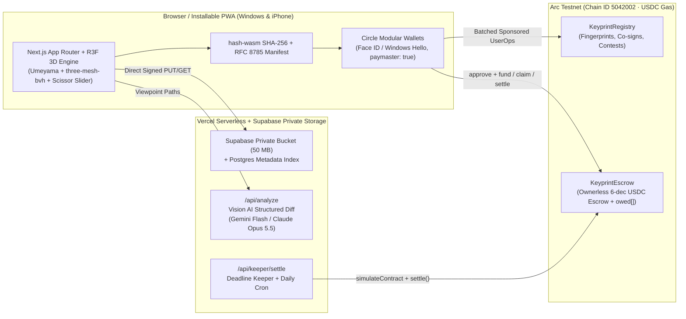

# Keyprint

**Your apartment. Its history. Your proof.**

Keyprint is a renter-owned, tamper-evident 3D record of an apartment paired with a rule-enforced USDC security-deposit escrow on Arc Testnet. Built for the **UBC 2026 Hackathon** (**Main Track:** Consumer Applications · **Chain Award:** Best use of Arc).

- **Live Demo:** [https://keyprint-two.vercel.app](https://keyprint-two.vercel.app)
- **Demo Video (2–3 min):** _Add unlisted YouTube / Google Drive link here_

---

## Try It in Two Minutes

1. Open **`/sample`** in an incognito window for an illustrative walkthrough: a public research scan of a real apartment with move-in pins, the before/after time slider, an example AI suggestion, and an example `$40` / `$160` split. (The sample's claims and split are scripted to show the flow; the real Arc lease is linked below.)
2. Download both sample `.glb` files (original + 1-byte-changed copy) and drop them into **`/verify`**.
3. Open **`/unit/new`** to seal a 3D scan and spatial pins in **Solo mode** with your own passkey (no landlord and no deposit required).

---

## The Problem and the Flip

| | Today | With Keyprint |
| --- | --- | --- |
| **Who holds the deposit** | The landlord | An ownerless escrow contract on Arc that neither side controls |
| **Who holds the evidence** | The landlord's phone | Both sides; each file's fingerprint is sealed on Arc the moment it's added, and the landlord co-signs or contests it |
| **Who has to prove damage** | The renter must prove they didn't do it | The landlord must pin each claim to a spot in the 3D record and price it |
| **If nobody does anything** | The landlord keeps the money | Once the deadline passes, the full deposit goes back to the renter: Keyprint's keeper triggers it, and anyone can |

---

## Architecture (3 Layers)



1. **Browser (Next.js App Router + React Three Fiber + three-mesh-bvh + hash-wasm):**
   - Hashes `.glb` scans and photos in streaming chunks (`hash-wasm`), canonicalizes manifests per RFC 8785 (`canonicalize`), and signs gas-sponsored ERC-4337 UserOperations with passkeys via Circle Modular Wallets.
   - Aligns move-out scans to move-in coordinates using the Umeyama similarity transform (`ml-matrix`) and gates comparisons on surface agreement (`three-mesh-bvh`, median gap `< 2 cm` and `>= 60%` within `5 cm`).
   - Renders matching 1024×768 4:3 before/after pairs offscreen and matches AI suggestions to move-in pins strictly in geometric code.
2. **Arc Testnet (Chain ID `5042002`):**
   - `KeyprintRegistry`: ownerless, immutable onchain registry storing manifest SHA-256 hashes, timestamps, monotonic seal sequence numbers, and per-account `acknowledgedAt` co-signs.
   - `KeyprintEscrow`: ownerless, non-upgradeable 6-decimal ERC-20 USDC (`0x3600000000000000000000000000000000000000`) escrow enforcing lease terms, evidence checks, claim windows, two-sided silence rules, reviewer dispute resolution, permissionless settlement, and non-blocking `owed[]` payouts.
3. **Private Storage & Server Routes (Supabase + Vercel):**
   - 3D scans and photos live in a **private** Supabase Storage bucket (`keyprint-private`) uploaded directly from the browser via short-lived signed URLs (never public IPFS, never routed through Vercel's 4.5 MB limit).
   - `/api/analyze` runs structured vision comparison server-side (**Google Gemini Flash** via `GEMINI_API_KEY` or **Anthropic Claude Opus 5.5** via `ANTHROPIC_API_KEY`, validated with Zod) with Supabase caching keyed by record IDs + view IDs + prompt version.
   - `/api/keeper/settle` simulates and triggers permissionless `settle(leaseId)` once deadlines expire (backed by a daily Vercel Cron job).

---

## How Keyprint Uses Arc & Circle

- **Circle Modular Wallets (`@circle-fin/modular-wallets-core` + `viem`):** Passkey-controlled smart accounts (`toPasskeyTransport`, `toWebAuthnCredential`, `toModularTransport(${clientUrl}/arcTestnet)`, `toCircleSmartAccount`) so renters sign in with Face ID or Windows Hello and never handle a seed phrase. Main screens talk in dollars; account IDs only appear where you share or paste them.
- **Gas Station Sponsorship (`paymaster: true`):** Every passkey action (seal, co-sign, priced-pin claim, dispute, withdrawal, manual release) runs as a gas-sponsored UserOperation on Arc Testnet, batching several contract calls into one touch where a step needs them (for example seal move-in + pins + approve + fund). The deadline keeper's `settle()` is a plain transaction from Keyprint's keeper account.
- **USDC Native & ERC-20 Model:** Deposits and payouts use the 6-decimal ERC-20 interface (`0x3600000000000000000000000000000000000000`), while Arc gas is metered in 18-decimal native USDC (measured from `actualGasCost` on UserOp receipts and never mixed with deposit units).

### Arc Testnet Contracts

| Contract | Address | Explorer |
| --- | --- | --- |
| USDC (ERC-20 interface, 6 decimals) | `0x3600000000000000000000000000000000000000` | [Arc Testnet Explorer](https://explorer.testnet.arc.io/address/0x3600000000000000000000000000000000000000) |
| `KeyprintRegistry` | `0x57cF232F1e0c250d6bcA49Af6461ee477f450341` | [Arc Testnet Explorer](https://explorer.testnet.arc.io/address/0x57cF232F1e0c250d6bcA49Af6461ee477f450341) |
| `KeyprintEscrow` (`MIN_WINDOW = 60s`) | `0x97d85aC09C01ed2dBf2611b7B91fF4BB2A69654a` | [Arc Testnet Explorer](https://explorer.testnet.arc.io/address/0x97d85aC09C01ed2dBf2611b7B91fF4BB2A69654a) |

### A Full Lease on Arc Testnet & Measured USDC Gas Cost

One complete lease lifecycle ran on Arc Testnet via `scripts/run-arc-verification.mjs`, from two plain test accounts (**12 transactions**: create, seal move-in, approve, fund, co-sign, seal move-out, end lease, seal claim evidence, file claim, close claims, accept, settle). In the app, several of these steps are batched into a single passkey touch. Measured native gas fees totaled **$0.031613 USDC**:

- **Lease ID:** `0xb43bc65443fd2847b3c37b0fc08035c033a290ddf75707993649f44e1ea2f1a4`
- **Co-Signed Move-In Record ID (verifiable live at `/verify`):** `0xf832a330403ee154d148051bccdd595d2e82d523142d8ae3dc4950d747818d50`
- **Total Measured Arc Gas Cost:** **`$0.031613` USDC** across 12 transactions (block `72,986,126`–`72,986,180`)

| Step | Block | Gas Fee (USDC) | Explorer |
| --- | --- | --- | --- |
| `createLease` | `72,986,126` | `$0.004768` | [View tx](https://explorer.testnet.arc.io/tx/0x2e1fdfc4a23dd512b0dfc7609bd7ee648179b69eff6577cdba454bab51db795c) |
| `seal(MoveInScan)` | `72,986,127` | `$0.003045` | [View tx](https://explorer.testnet.arc.io/tx/0x8dec8fb7abe28012b87de674f8d12f6709ad0937857a3635a73b86ff51733d26) |
| `USDC.approve(2 USDC)` | `72,986,129` | `$0.001164` | [View tx](https://explorer.testnet.arc.io/tx/0x20d9c052e595f58844add3730f7d9eb1072ec34ae48c84a03a353923f6a0bbff) |
| `fund(2 USDC)` | `72,986,131` | `$0.003268` | [View tx](https://explorer.testnet.arc.io/tx/0x2d55caff5ecf5a619844fc86f71f3361c2b2228a72a5cadad603d4d67c4dd2a8) |
| `acknowledge` (landlord co-sign) | `72,986,140` | `$0.001016` | [View tx](https://explorer.testnet.arc.io/tx/0x0e385aaf44650fb858854374cb7db81df7f233b3f7efbd441880595036670868) |
| `seal(MoveOutScan)` | `72,986,143` | `$0.003463` | [View tx](https://explorer.testnet.arc.io/tx/0x87989f384178a02ae23e2cd721f705a8a4de55b0b305bd54f67511704baddfa8) |
| `endLease` | `72,986,145` | `$0.001776` | [View tx](https://explorer.testnet.arc.io/tx/0xf75c154698b3b99b62810fe7ed7579f9f0a4e7068068ef49c93bdf00aa494d05) |
| `seal(ClaimEvidence)` | `72,986,154` | `$0.003463` | [View tx](https://explorer.testnet.arc.io/tx/0x668f5ed0d872b637ac1336c2cfadaa16850fbfb3dd6699291d7c0b6011a99bb7) |
| `fileClaim(1 USDC)` | `72,986,162` | `$0.005461` | [View tx](https://explorer.testnet.arc.io/tx/0x846039376d2f30a14baf5355c8a84ce90c695043a96c264d2cd7967b3733f015) |
| `closeClaims` | `72,986,164` | `$0.000692` | [View tx](https://explorer.testnet.arc.io/tx/0x3d765c9179f35344a5250e1e3c0374b583c2ada1566150f3c2c8474d058abdbf) |
| `acceptClaim` | `72,986,173` | `$0.000944` | [View tx](https://explorer.testnet.arc.io/tx/0xe6822ec3b085057af19c6760e684cd5b94883f66d3216ab91f1c8d0930a60e28) |
| `settle` (`$1` landlord / `$1` renter) | `72,986,180` | `$0.002553` | [View tx](https://explorer.testnet.arc.io/tx/0xc68f98a864221173d420503f60096e51b955ac2ced914557f66505d6caf81d1d) |

---

## Escrow Design & Risk Assumptions

- **No admin key, no pause, no proxy:** Nobody, Keyprint included, can freeze or redirect escrowed deposits.
- **Evidence checks:** `fund` requires a renter-sealed `MoveInScan` for that lease; `endLease` requires a post-funding `MoveOutScan` on or after `leaseEnd`; `fileClaim` requires a fresh, post-move-out landlord-sealed `ClaimEvidence` record (`>= 1 USDC`, max 20 claims, non-withdrawn total `<= deposit`).
- **Silence both ways:** An unanswered claim counts as accepted after `responseWindow`; an unresolved dispute counts as `$0` (returned to renter) after `resolveWindow`. Both defaults are disclosed on the terms card before the renter pays.
- **Non-blocking settlement (`owed[]`):** If USDC's issuer blocklists a recipient and a transfer fails during `settle()`, the failed amount is credited to `owed[address]` for `withdraw()` so one party can never freeze the other's payout.
- **Permissionless settlement:** Contracts do not self-execute; once the rules allow settlement, Keyprint's keeper calls `settle()`, the renter has a one-tap *"Release my deposit"* fallback, and any external account can trigger it.

---

## Local Setup & Deployment

### Prerequisites

- Node.js `22+`
- Foundry (run in **Git Bash** or **WSL** on Windows — see `contracts/README.md`)
- Circle Developer Console account (Client Key + Passkey Domain for `localhost` and your Vercel production domain)
- Supabase project (run `supabase/schema.sql` in SQL Editor)
- Anthropic API key (`ANTHROPIC_API_KEY`)

### 1. Install & Test Web App

```bash
cp .env.example .env.local
npm install
npm test
npm run dev
```

### 2. Build, Test & Deploy Contracts (Git Bash / WSL)

```bash
cd contracts
forge build && forge test -vv

# Deploy to Arc Testnet (MIN_WINDOW = 60 seconds for demo)
forge create src/KeyprintRegistry.sol:KeyprintRegistry \
  --rpc-url "$ARC_RPC" --private-key "$DEPLOYER_KEY" --broadcast

forge create src/KeyprintEscrow.sol:KeyprintEscrow \
  --rpc-url "$ARC_RPC" --private-key "$DEPLOYER_KEY" --broadcast \
  --constructor-args 0x3600000000000000000000000000000000000000 "$REGISTRY_ADDRESS" 60
```

---

## What I Built vs. Used & Honest Limitations

- **Built:** `KeyprintRegistry` and `KeyprintEscrow` smart contracts + full Foundry adversarial/fuzz/invariant suite, RFC 8785 manifest sealing & client-side `/verify`, 4-point Umeyama alignment + `three-mesh-bvh` surface agreement gate, dual-pass scissor time slider, offscreen 4:3 rendering + Claude Vision structured diff + geometric pin matching, settlement keeper, and all consumer screens.
- **Used:** Scaniverse/Polycam for 3D reconstruction (with Meta AI's real-world **Replica Dataset** `apartment_1.glb` RGB-D/LiDAR apartment scan optimized and prepared as the built-in reference move-in/move-out pair — with a clearly disclosed staged floor spill & scan-frame offset on the move-out copy — alongside direct `.glb` import for any phone scan), Circle Modular Wallets + Gas Station on Arc, Supabase private Storage/Postgres, and Claude Opus 5.5.
- **Honest limitations:** the built-in sample scans are Meta's Replica research scan (the move-out copy is the same scan with a synthetic frame offset and a staged stain), shown until our own phone LiDAR scans replace them; there is no server-side account login yet (every index write is checked against Arc, but anyone holding a lease link can open that lease's scans); 3D reconstruction comes from an external scanning app (in-app capture with device attestation is next); the move-in review window, alignment gate, and priced-pin schema are enforced by the app while the contract enforces evidence existence, authorship, ordering, deadlines, and payouts; settlement requires a trigger (Keyprint's keeper or any caller); real production deployment requires state-by-state legal review of deposit custody and silence defaults.
